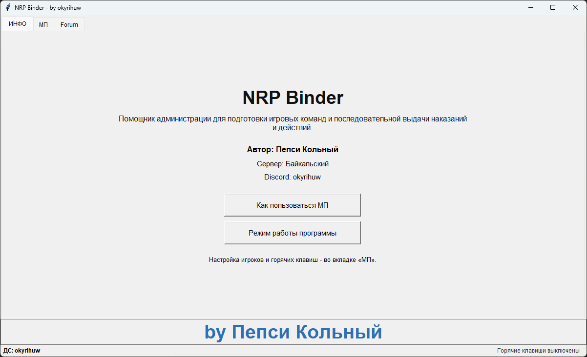
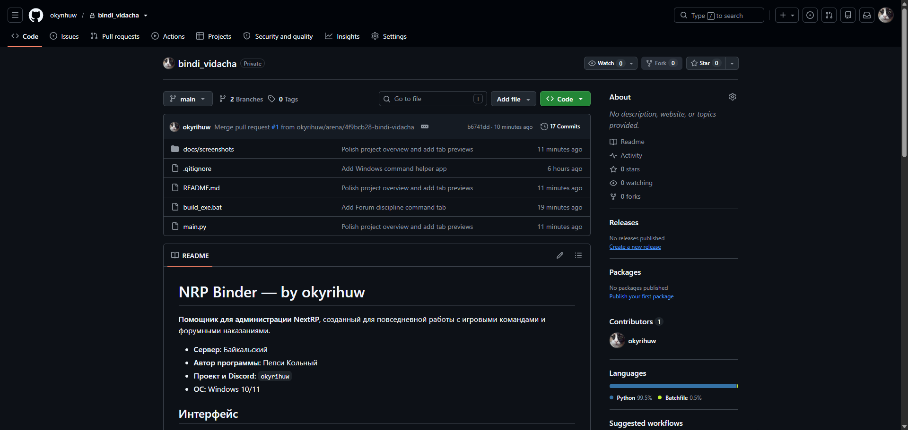
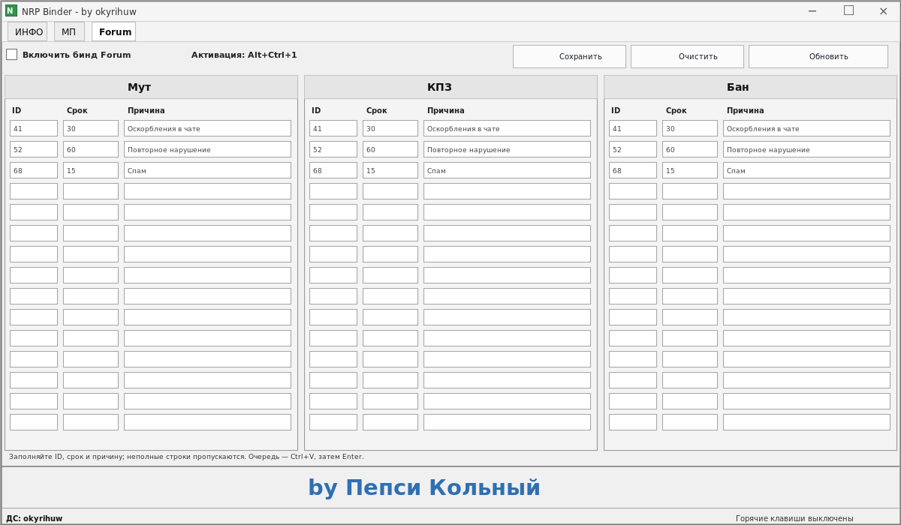

# NRP Binder - by okyrihuw

**Помощник для администрации NextRP**, созданный для повседневной работы с игровыми командами и форумными наказаниями.

- **Сервер:** Байкальский
- **Автор программы:** Пепси Кольный
- **Проект и Discord:** `okyrihuw`
- **ОС:** Windows 10/11

> **Важно:** для работы с NextRP запускайте NRP Binder от имени администратора. Если игра работает с повышенными правами, Binder тоже должен быть запущен от администратора.

## Интерфейс

Скриншоты МП и Forum сделаны в приложении. Для вкладки ИНФО показан иллюстративный предпросмотр.

<table>
  <tr>
    <th>ИНФО</th>
    <th>МП</th>
    <th>Forum</th>
  </tr>
  <tr>
    <td><a href="docs/screenshots/info.png"></a></td>
    <td><a href="docs/screenshots/mp.png"></a></td>
    <td><a href="docs/screenshots/forum.png"></a></td>
  </tr>
</table>

## Возможности

### МП

Четыре независимые группы игроков. В каждой - до 15 ID, два скина и три слота оружия. Пустые и некорректно заполненные поля пропускаются.

- Два скина делят список ID примерно пополам; при нечётном числе первая группа получает на одного игрока больше. Один заполненный скин применяется ко всем ID своей колонки.
- Оружие обрабатывается по каждому ID: сначала все заполненные слоты 1→2→3, затем следующий игрок.
- Здоровье и броня применяются ко всем заполненным ID.
- Бинды: **Ctrl+1** - телепорт, **Ctrl+2** - скины, **Ctrl+3** - оружие, **Ctrl+4** - здоровье, **Ctrl+5** - броня, **Ctrl+6** - возрождения.

### Forum

Три независимые колонки: **Мут**, **КПЗ**, **Бан**. Для записи указываются ID, срок и причина. Полностью заполненные строки формируют команды:

| Колонка | Команда |
| --- | --- |
| Мут | `pmute ID СРОК ПРИЧИНА` |
| КПЗ | `jail ID СРОК ПРИЧИНА` |
| Бан | `pban ID СРОК ПРИЧИНА` |

Неполные строки пропускаются. Бинд очереди Forum - **Alt+Ctrl+1**. Переключатели биндов у МП и Forum независимы; приложение проверяет конфликты сочетаний между включёнными вкладками. Кнопки сохранения, очистки и загрузки в каждой вкладке относятся только к её собственным данным.

### Полуавтоматическая очередь

Приложение готовит команды, но не управляет игровой консолью и не нажимает клавиши за пользователя. Откройте F8 вручную, оставьте игру активной и нажмите нужный бинд. Затем для каждой команды физически нажимайте **Ctrl+V**, после чего **Enter**. На Ctrl+V программа подготовит следующую команду; после последней вставки буфер очищается.

При копировании показывается короткое уведомление поверх окон, без перехвата фокуса. Команды помечаются так, чтобы Windows не добавляла их в историю **Win+V** и облачный буфер; существующие записи истории это не удаляет. В эксклюзивном полноэкранном режиме Windows может закрывать обычные оконные оверлеи, поэтому для уведомления поверх игры нужен оконный или безрамочный полноэкранный режим. Программа не имитирует нажатия и не обходит античит.

## Запуск и сборка

Для запуска исходников на Windows нужны Python 3.10+ и Tcl/Tk:

```bat
python main.py
```

Для сборки автономного приложения запустите `build_exe.bat`. Скрипт собирает `dist\NRP Binder.exe` с помощью PyInstaller. Готовый EXE запускайте через контекстное меню Windows: **Запуск от имени администратора**.

## Авторство

**NRP Binder - by okyrihuw** - административный помощник для сервера **Байкальский**. Программа и интерфейс - **by Пепси Кольный**. Discord для связи: **okyrihuw**.
